<div align="center">


# Evolution and Future Trends in Topological Data Analysis

**Διπλωματική Εργασία: Εξέλιξη και μελλοντικές τάσεις στην Τοπολογική Ανάλυση Δεδομένων**

*Diploma Thesis · Department of Computer Engineering & Informatics · University of Patras · 2026*

[📄 Thesis (Greek, PDF)](diploma-thesis.pdf) · [📄 English translation (PDF)](diploma-thesis-EN.pdf)


</div>

---

## Overview

Topological Data Analysis (TDA) treats data not only as a set of values but as a carrier of **shape, connectivity and multiscale structure**. This thesis is a systematic and critical literature review of the field: its mathematical foundations, historical development, core techniques, applications, limitations and future directions.

|  |  |
|---|---|
| **Author** | Achmet Kiourt-Mechmetali (A.M. 1084672) |
| **Supervisor** | Prof. Athanasios Andrikopoulos |
| **Institution** | Department of Computer Engineering & Informatics, School of Engineering, University of Patras |
| **Year** | 2026 |
| **Type** | Bibliographic (literature-based) thesis |
| **Keywords** | Topological Data Analysis, persistent homology, Mapper, machine learning, artificial intelligence, multiscale analysis |

## Abstract

This diploma thesis examines the evolution and future trends of Topological Data Analysis, a field that has emerged as an important tool in contemporary data science. TDA approaches data not only as a set of values, but also as carriers of shape, connectivity and multiscale structure. Its central premise is that many critical properties of complex data are not easily captured by conventional statistical or linear methods but become more visible when data are studied through their overall "shape."

The thesis presents systematically the theoretical foundation of TDA, its historical development, its main techniques and algorithmic forms, its key applications, and its most important challenges and prospects. It explores applications in biology, genetics, medicine, neuroscience, physics, astronomy, environmental sciences, computer science and data science, and, to a more limited extent, in the social and economic sciences, while highlighting key limitations such as computational complexity, difficulties of interpretation and still limited diffusion in certain disciplines.

The overall conclusion is that TDA constitutes a rapidly evolving interdisciplinary framework with particularly important prospects, especially in combination with artificial intelligence and the development of new computational infrastructures.

## Contents

| # | Chapter | Topics |
|---|---------|--------|
| 1 | **Introduction** | Definition and purpose of TDA · scientific & technological context · research gaps and questions · thesis structure |
| 2 | **Mathematical Background** | Metric & topological spaces · simplicial complexes, chains, boundary operator · homology & Betti numbers · Čech, Vietoris–Rips and α-complexes |
| 3 | **Historical Evolution** | Early stages & theoretical foundation · integration into machine learning and computer science |
| 4 | **Techniques & Algorithms** | Persistent homology and Mapper · scale analysis & topological graphs · software tools and systems |
| 5 | **Applications** | Biology & genetics · physics & astronomy · environmental sciences · computer science & data science · social & economic sciences |
| 6 | **Challenges & Limitations** | Computational complexity & high-dimensional data · interpretability & transparency · limited adoption outside the natural sciences |
| 7 | **Future Trends** | TDA and artificial intelligence · interdisciplinary use · need for new software and infrastructure |
| 8 | **Conclusions** | Findings per chapter · answers to the research questions · final conclusions |

## Research questions

1. How can the evolution of TDA be mapped, from early computational constructions to today's tool ecosystems and integration with machine learning, and which milestones explain this shift?
2. Which representations of topological summaries are most useful per problem category, and by what criteria can a choice be justified?
3. What are the practical limits of TDA scaling today, and which algorithmic directions are most promising for large datasets?
4. What changes when analysis moves from single-parameter to multiparameter topological descriptions?
5. How can realistic evaluation protocols for TDA be formulated, so that topological information is documented as added value rather than an unverified interpretive narrative?

## Snapshots from the thesis

### The TDA pipeline

<p align="center">
  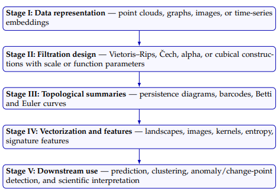<br>
  <sub><b>Figure 1.</b> Step-by-step TDA workflow, from data representation and filtration design to topological summaries, vectorization and downstream use [75].</sub>
</p>

### From point clouds to complexes (Chapter 2)

<table>
<tr>
<td align="center" width="33%">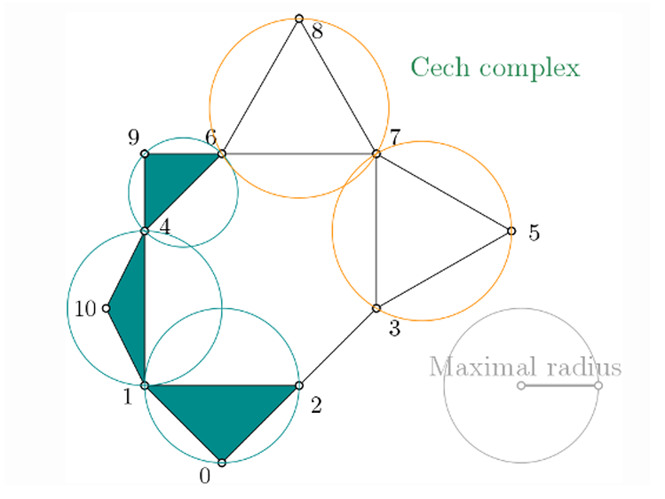<br><sub><b>Figure 2.</b> Čech complex [68]</sub></td>
<td align="center" width="33%">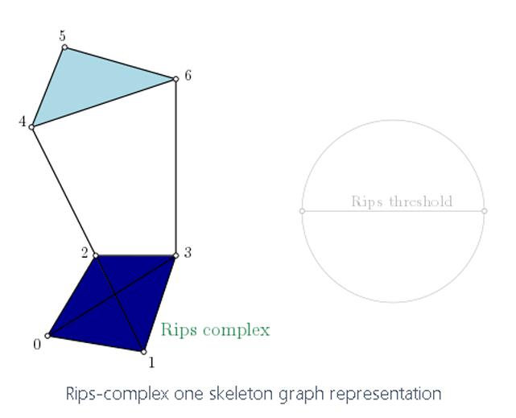<br><sub><b>Figure 3.</b> Construction of the Vietoris–Rips complex [69]</sub></td>
<td align="center" width="33%">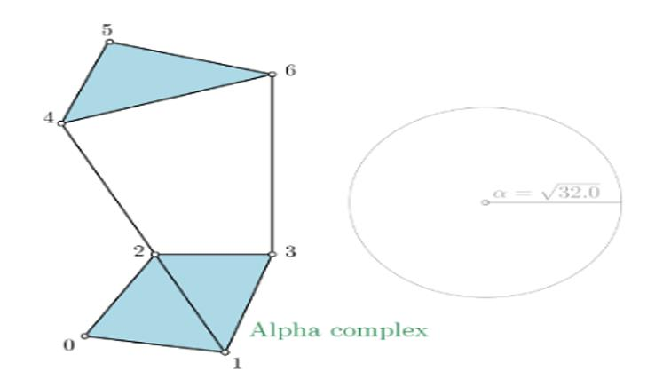<br><sub><b>Figure 4.</b> Alpha complex as a subset of the Delaunay triangulation [70]</sub></td>
</tr>
</table>

### Software tools and scientific visualization (Chapter 4)

<table>
<tr>
<td align="center" width="50%">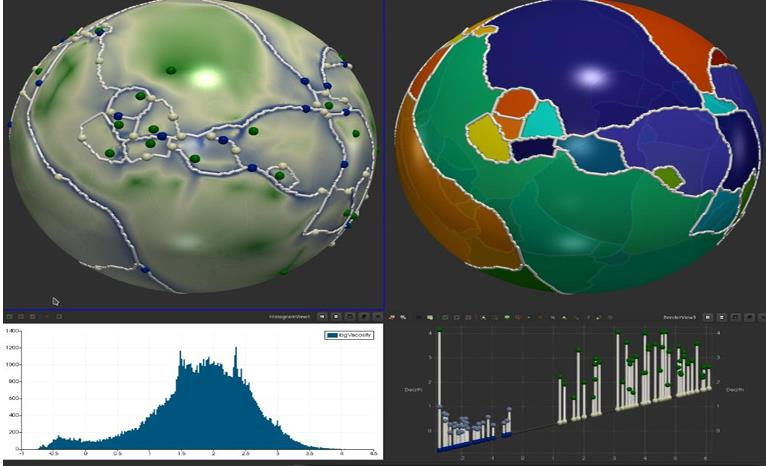<br><sub><b>Figure 5.</b> Segmentation of tectonic plates using topological simplification and the Morse–Smale complex [71]</sub></td>
<td align="center" width="50%">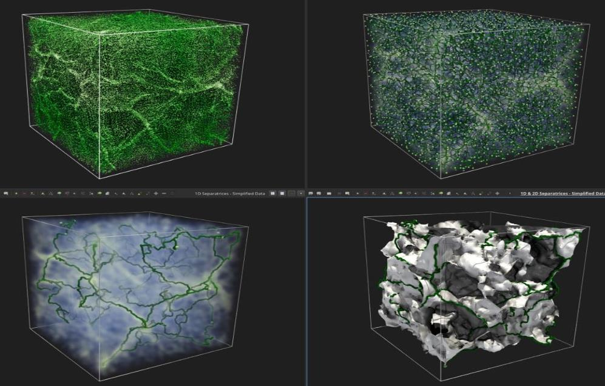<br><sub><b>Figure 6.</b> Dark matter simulation analysed with topological simplification and the Morse–Smale complex [72]</sub></td>
</tr>
</table>

<p align="center">
  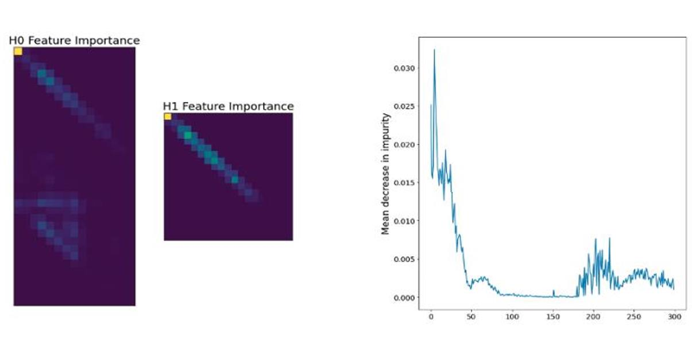<br>
  <sub><b>Figure 7.</b> Visualization of feature importance [48]</sub>
</p>

### Neuroscience and environmental data (Chapter 5)

<table>
<tr>
<td align="center" width="50%">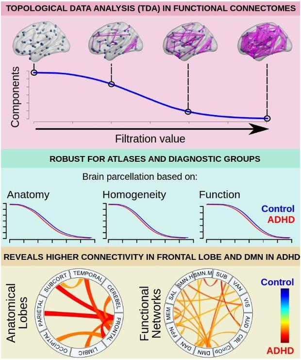<br><sub><b>Figure 8.</b> TDA on brain connectomes [73]</sub></td>
<td align="center" width="50%">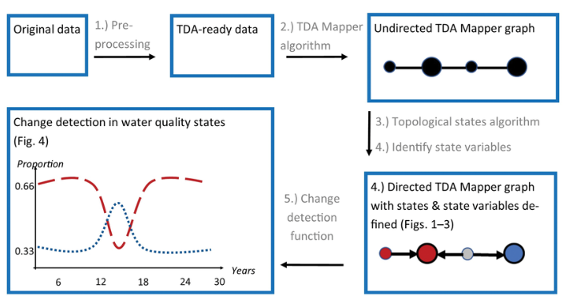<br><sub><b>Figure 9.</b> Mapper-based workflow turning multidimensional environmental data into a topological network to identify ecological states and their transitions over time [43]</sub></td>
</tr>
</table>

### Computer science, machine learning and AI (Chapter 5)

<table>
<tr>
<td align="center" width="50%">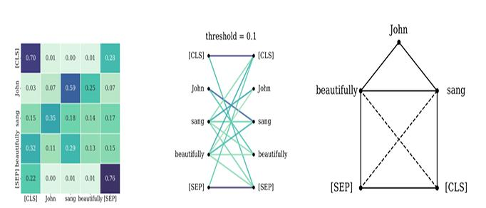<br><sub><b>Figure 10.</b> Transformation of an attention matrix into a graph [47]</sub></td>
<td align="center" width="50%">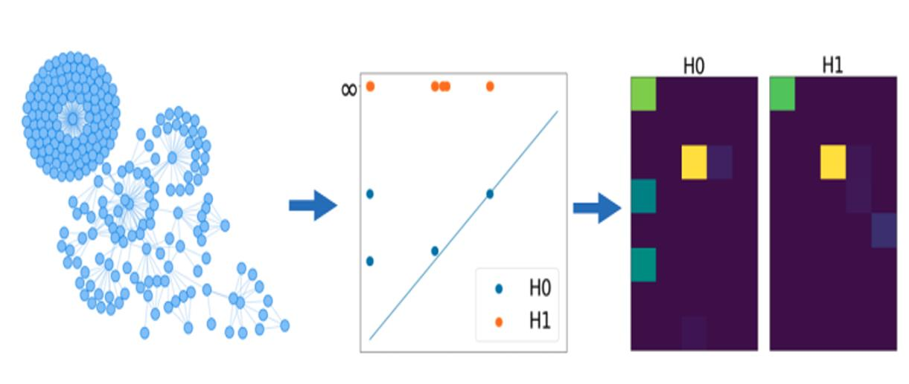<br><sub><b>Figure 11.</b> Embedding logs into a complex filtration and producing persistence diagrams / images for anomaly detection [48]</sub></td>
</tr>
<tr>
<td align="center">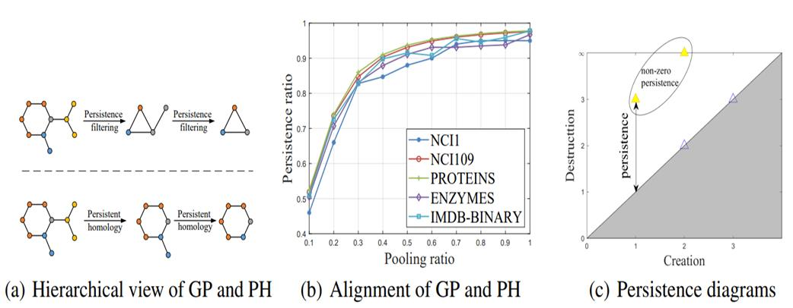<br><sub><b>Figure 12.</b> Bridge between graph pooling and persistent homology [74]</sub></td>
<td align="center">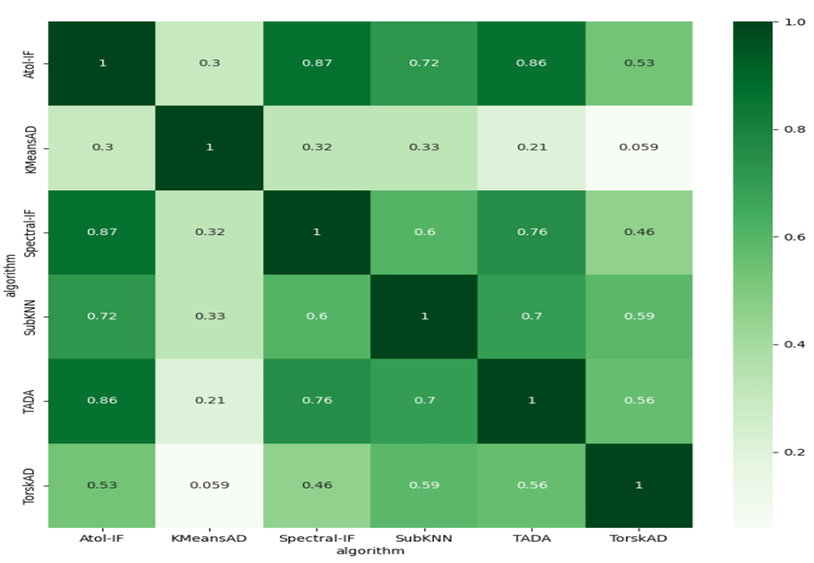<br><sub><b>Figure 13.</b> Correlation of anomaly-detector performance across benchmarks [45]</sub></td>
</tr>
</table>

### Challenges: multiparameter persistence (Chapter 6)

<table>
<tr>
<td align="center" width="50%">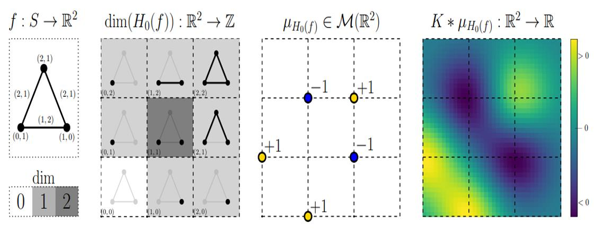<br><sub><b>Figure 14.</b> Multiparameter representation pipeline [59]</sub></td>
<td align="center" width="50%">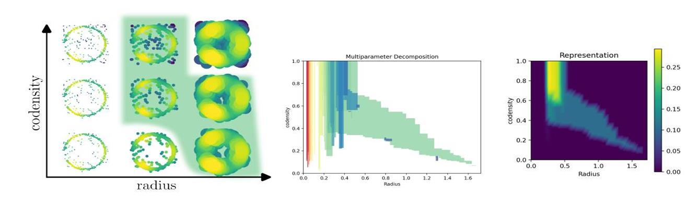<br><sub><b>Figure 15.</b> Example of a filtration and a candidate decomposition [60]</sub></td>
</tr>
</table>

<p align="center">
  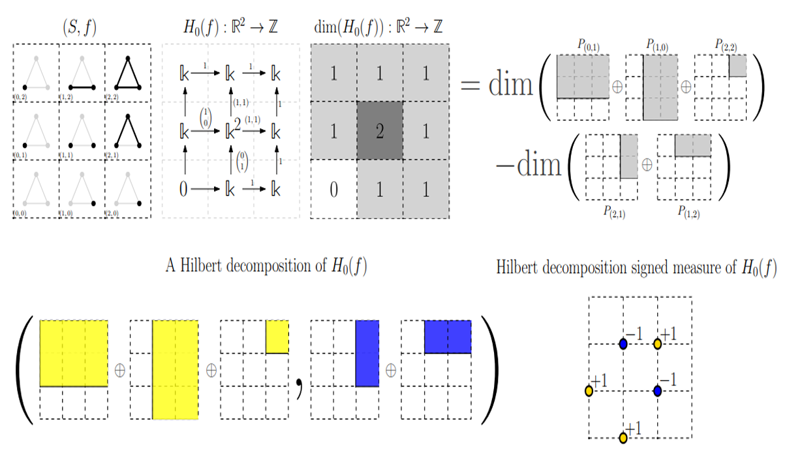<br>
  <sub><b>Figure 16.</b> Visual decomposition of the Hilbert function and its correspondence to a signed measure [59]</sub>
</p>

### Limited adoption outside the natural sciences (Chapter 6)

<p align="center">
  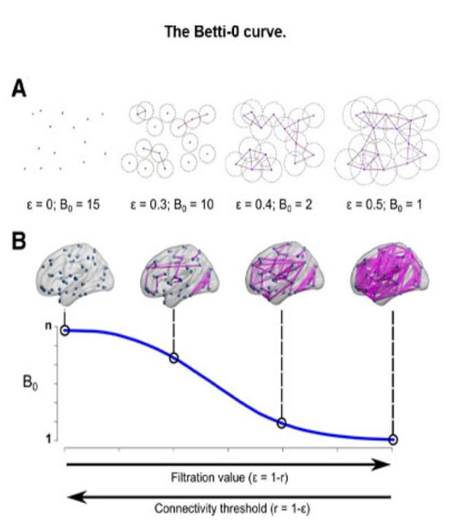<br>
  <sub><b>Figure 17.</b> Betti-0 curve as a function of the filtration [27]</sub>
</p>

> Figures are reproduced from the thesis; the bracketed numbers refer to the thesis bibliography, which credits the original sources.

## Repository structure

```
.
├── README.md
├── diploma-thesis.pdf        # Original thesis (Greek)
├── diploma-thesis-EN.pdf     # English translation
└── assets/                   # Figures used in this README
    ├── university-logo.png
    └── figure-01.png … figure-17.png
```

## Citation

```bibtex
@thesis{kiourt2026tda,
  author      = {Kiourt-Mechmetali, Achmet},
  title       = {Evolution and Future Trends in Topological Data Analysis},
  school      = {University of Patras, Department of Computer Engineering and Informatics},
  address     = {Patras, Greece},
  year        = {2026},
  note        = {Diploma thesis. Supervisor: Athanasios Andrikopoulos}
}
```

## License & rights

© 2026 Achmet Kiourt-Mechmetali. All rights reserved unless stated otherwise. Third-party figures remain the property of their original authors, as cited in the thesis.
